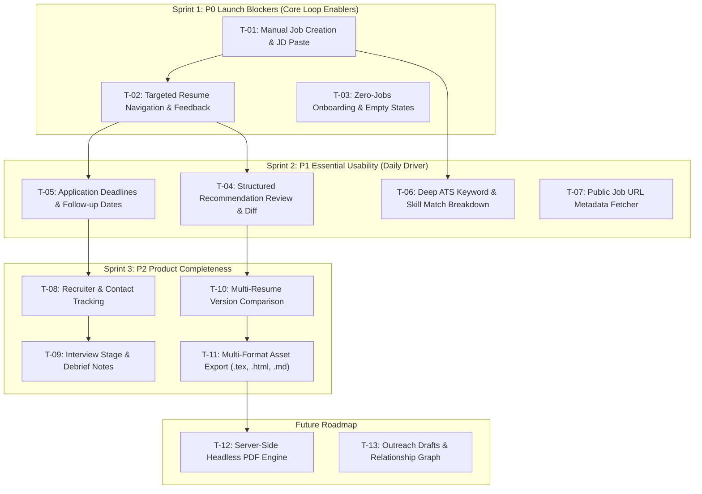

# CareerOS — MVP Execution Plan & Prioritized Backlog

**Document Version:** 1.0  
**Status:** Approved for Post-Stabilization Product Execution  
**Target Goal:** Bridge the gap between stabilized architecture and a genuinely usable personal career management platform and credible public alpha.

---

## 0. Delivery Status and Recorded Deviations (updated 2026-11-18)

Branch: `feat/mvp-job-intake-and-reminders`. Status is based on the code and on
browser verification against a local stack, not on the task descriptions below.

| Task | Status | Notes |
| --- | --- | --- |
| T-01 Manual job entry | Done | Jobs are now tenant-aware (see deviation 1). Duplicate postings are detected, not re-created. |
| T-02 Targeted resume feedback | Done | Opens the new version; links it to the job's application (see deviation 4). |
| T-03 First-run empty state | Done | Distinguishes new workspace / all dismissed / filtered / saved-only. Sample jobs deliberately not built (deviation 2). |
| T-04 Recommendation diff | Not started | |
| T-05 Follow-up / deadline dates | Done | `interviewDate` deferred (deviation 3). |
| T-06 ATS keyword breakdown | Not started | |
| T-07 URL importer | Done | Draft-only. IPv6 guard is an allow-list (global unicast only). |

Deviations from the original task text, decided deliberately:

1. **Private jobs (T-01).** The plan assumed `Job` was a shared table. A pasted
   job must not be visible to other workspaces, so `jobs.owner_organization_id`
   was added (NULL = shared catalog). Visibility is enforced in the API on every
   job read path and in the database by triggers
   (`20261118120000_job_owner_integrity_triggers`): an Application, JobMatch or
   WorkspaceJobState can never reference another workspace's private job.
2. **"Load sample demonstration jobs" (T-03) is not implemented.** It would
   write demo rows into real workspaces. The acceptance criterion is amended to:
   a new user sees a clear empty state with "Paste your first job" and an
   optional live-fetch action. Revisit only if a clearly separated demo
   workspace is introduced.
3. **`interviewDate` (T-05) is deferred to T-09.** A single date cannot model
   several interview rounds; it belongs with the `InterviewRound` model.
4. **Targeted resume to application link (T-02).** A new targeted version is
   attached to the job's application when it is still `saved` or has no resume
   version yet. After applying, a newer version never replaces the one that was
   submitted. Tracking a job later picks up the latest targeted version
   automatically.

Known limitations of what shipped: the URL importer relies on application-level
SSRF protections only (no network egress allow-list) and cannot read pages that
need JavaScript or a login; reminders use calendar-day (UTC midnight) semantics.

### Technical backlog carried over (must not be buried by feature work)

- PostgreSQL is the only database: CockroachDB removal / standardization stays
  settled.
- Missing foreign-key and tenant-integrity constraints stay tracked (private-job
  references are now trigger-enforced; other gaps remain open).
- Migration reproducibility from an empty database is a release requirement.
- Dead-code cleanup stays in the stabilization follow-up.
- Infrastructure additions (queues, object storage) stay deferred until a real
  requirement justifies them.

---

## 1. Prioritization Framework

All backlog tasks are categorized using a strict value-first taxonomy:

- **P0 — Launch Blockers & Core Journey Enablers:**  
  Features without which a user cannot execute the core career search loop (finding/adding a job, generating a targeted resume, and tracking the application).
- **P1 — Essential Personal Usability:**  
  Features required for CareerOS to function as the primary, daily tool for an active job search.
- **P2 — Product Completeness:**  
  High-value additions that elevate CareerOS above generic spreadsheet trackers and AI resume wrappers.
- **P3 — Future Roadmap:**  
  Advanced integrations and automations deferred until post-launch stability.

---

## 2. Dependency Graph & Execution Sequence

---

## 3. P0 — Launch Blockers & Core Loop Enablers

### Task T-01: Manual Job Creation & Job Description Paste
- **Feature Name:** Manual Job Entry & Normalization
- **Current Implementation Status:** Partial. `JobsService.createJob()` exists in `apps/api/src/jobs/jobs.service.ts` and `PrismaJobsRepository.upsertCanonicalJob()` works. However, no API controller endpoint exists, no BFF route exists, and no UI dialog exists.
- **Missing Functionality:**
  1. API endpoint: `POST /workspaces/:workspaceId/jobs`.
  2. Next.js BFF endpoint: `POST /api/jobs`.
  3. Frontend UI modal/sheet: "Add Custom Job" with fields for `Title`, `Company`, `Location`, `Remote Policy`, `Job Description`, `Salary Range`, and `Source URL`.
  4. Auto-triggering normalization and deterministic match calculation against the active Master Career Profile upon creation.
- **Files/Modules Requiring Changes:**
  - `apps/api/src/jobs/jobs.controller.ts` (expose `createCustomJob`)
  - `apps/api/src/jobs/jobs.service.ts` (wire custom job creation with workspace state)
  - `apps/web/app/api/jobs/route.ts` (add `POST` handler with session validation)
  - `apps/web/components/jobs/job-board.tsx` (add "Add Job" button and state)
  - `apps/web/components/jobs/add-job-dialog.tsx` (new component)
- **Dependencies:** None.
- **Acceptance Criteria:**
  - User can click "Add Job" in Job Radar, paste a full JD from Greenhouse or LinkedIn, and save it.
  - The job appears immediately in the Job Radar list with computed match score and skills breakdown.
  - The job can be saved, dismissed, or targeted for a resume.
- **Testing Requirements:**
  - Unit test in `jobs.controller.spec.ts` for `POST /workspaces/:id/jobs`.
  - Integration test verifying job normalization and automatic match calculation.
- **Estimated Effort:** 1.5 days.
- **Priority & Reasoning:** **P0.** Absolute launch blocker. Users cannot use CareerOS for real job searches if they cannot input the jobs they are applying to.

---

### Task T-02: Targeted Resume Creation Navigation & Feedback Loop
- **Feature Name:** Targeted Resume Generation Navigation
- **Current Implementation Status:** Backend functional; frontend disconnected. Clicking "Targeted Resume" in `JobDetailsDrawer` creates a `ResumeVersion` in PostgreSQL, but provides no user feedback or navigation.
- **Missing Functionality:**
  1. Success toast / notification informing the user that the targeted version was created.
  2. Direct navigation button or automatic redirect to `/resumes/[resumeId]/versions/[versionId]`.
  3. Association of the targeted `resumeVersionId` with the corresponding `Application` record when tracking the job.
- **Files/Modules Requiring Changes:**
  - `apps/web/components/jobs/job-details-drawer.tsx`
  - `apps/web/components/jobs/job-board.tsx`
- **Dependencies:** Task T-01.
- **Acceptance Criteria:**
  - When a user clicks "Targeted Resume", the button shows loading state, and upon completion:
    - If successful, displays a success prompt: "Targeted resume created! [View Version ->]".
    - Provides a direct link to inspect the tailored version.
    - If the user tracks the application, the newly generated `resumeVersionId` is linked.
- **Testing Requirements:**
  - BFF test verifying payload forwarding.
  - Component interaction tests in `apps/web`.
- **Estimated Effort:** 0.5 days.
- **Priority & Reasoning:** **P0.** Resolves the primary usability dead-end in the core user journey.

---

### Task T-03: Zero-Jobs Onboarding & Empty States
- **Feature Name:** First-Run Job Radar Guidance
- **Current Implementation Status:** Generic empty state exists (`job-empty-state.tsx`), but provides no actionable pathway when `APIFY_API_TOKEN` is not configured.
- **Missing Functionality:**
  1. Context-aware empty state explaining that live scraping is optional.
  2. Primary call-to-action: "Paste your first job description" (triggering the T-01 modal).
  3. Secondary call-to-action: "Load sample demonstration jobs" (triggering a client call to load pre-seeded demo opportunities).
- **Files/Modules Requiring Changes:**
  - `apps/web/components/jobs/job-empty-state.tsx`
  - `apps/web/components/jobs/job-board.tsx`
- **Dependencies:** Task T-01.
- **Acceptance Criteria:**
  - A brand-new user with an empty database sees an encouraging, clear onboarding empty state rather than a blank table.
  - One-click access to paste a JD or load sample jobs.
- **Testing Requirements:**
  - Empty state component unit test.
- **Estimated Effort:** 0.5 days.
- **Priority & Reasoning:** **P0.** Critical for public demonstrations, LinkedIn announcements, and first-time user retention.

---

## 4. P1 — Essential Personal Usability

### Task T-04: Structured Recommendation Review & Section Diff
- **Feature Name:** Targeted Resume Recommendation Review
- **Current Implementation Status:** Partial. AI Coach (`/coach`) has section-level recommendations; `ResumeVersionViewer` displays frozen snapshots and targeting rationale, but does not provide an interactive diff.
- **Missing Functionality:**
  1. In `ResumeVersionViewer`, render a visual comparison of prioritized skills, projects, and experiences versus the baseline profile.
  2. Allow the user to toggle which bullet points or skills to include/exclude before finalizing their application asset.
- **Files/Modules Requiring Changes:**
  - `apps/web/components/resumes/resume-version-viewer.tsx`
  - `apps/web/components/resume-intelligence/resume-version-comparison.tsx`
  - `apps/web/lib/latex-engine.ts`
- **Dependencies:** Task T-02.
- **Acceptance Criteria:**
  - User can view exactly which items the targeting engine selected and why.
  - User can override selections and save an updated snapshot.
- **Testing Requirements:**
  - Snapshot persistence unit test.
- **Estimated Effort:** 2 days.
- **Priority & Reasoning:** **P1.** Fulfills the CareerOS promise of explainable, user-controlled targeting over blind AI generation.

---

### Task T-05: Application Deadlines, Follow-up Dates & Reminders
- **Feature Name:** Application Follow-Up & Timeline Management
- **Current Implementation Status:** Minimal. Only `appliedAt` timestamp and generic `notes` string exist.
- **Missing Functionality:**
  1. Database migration adding `followUpAt: DateTime?`, `deadlineAt: DateTime?`, and `interviewDate: DateTime?` to `Application`.
  2. UI datepickers and reminders in `ApplicationDetailView` and `ApplicationTrackerView`.
  3. Dashboard widget highlighting upcoming deadlines and overdue follow-ups.
- **Files/Modules Requiring Changes:**
  - `apps/api/prisma/schema.prisma`
  - `apps/api/prisma/migrations/*`
  - `apps/api/src/applications/applications.types.ts` & `applications.service.ts`
  - `apps/web/components/applications/application-detail-view.tsx`
  - `apps/web/components/dashboard/career-dashboard-view.tsx`
- **Dependencies:** None.
- **Acceptance Criteria:**
  - User can set a follow-up reminder date on any application.
  - Applications approaching deadlines or overdue for follow-ups are visually badged.
- **Testing Requirements:**
  - Prisma migration integrity test.
  - Service update test for date fields.
- **Estimated Effort:** 1.5 days.
- **Priority & Reasoning:** **P1.** Essential for managing a real-world active job search without dropping opportunities.

---

### Task T-06: In-Depth ATS Keyword & Skill Match Breakdown
- **Feature Name:** ATS Keyword Coverage & Gap Visualizer
- **Current Implementation Status:** Match percentage and lists of `matchedSkills` / `missingSkills` exist.
- **Missing Functionality:**
  1. Detailed breakdown distinguishing between "Hard Technical Skills", "Tools/Frameworks", and "Domain Knowledge".
  2. Clear ATS keyword coverage meter showing exact percentage of job-required terms present in the user's Master Profile.
  3. Actionable recommendations: "Add experience demonstrating [Skill] to improve match by +12%".
- **Files/Modules Requiring Changes:**
  - `apps/api/src/jobs/job-matching.service.ts`
  - `apps/web/components/jobs/job-details-drawer.tsx`
  - `apps/web/components/jobs/job-match-badge.tsx`
- **Dependencies:** Task T-01.
- **Acceptance Criteria:**
  - Drawer displays an interactive keyword coverage breakdown.
  - Hovering/clicking a missing skill shows suggestions for where in the profile it could be evidenced.
- **Testing Requirements:**
  - Matching service unit tests with edge-case skills.
- **Estimated Effort:** 1.5 days.
- **Priority & Reasoning:** **P1.** Delivers immediate, high-value insight to the user before submitting applications.

---

### Task T-07: Public Job URL Metadata Fetcher
- **Feature Name:** Quick-Import from Job URL
- **Current Implementation Status:** None.
- **Missing Functionality:**
  1. In the "Add Job" modal, provide a "Import from URL" field.
  2. Backend service fetches public HTML, strips boilerplate, and uses regex/OpenGraph heuristics (or lightweight AI if configured) to extract title, company, and description.
- **Files/Modules Requiring Changes:**
  - `apps/api/src/jobs/ingestion/job-url-scraper.service.ts` (new service)
  - `apps/api/src/jobs/jobs.controller.ts`
  - `apps/web/components/jobs/add-job-dialog.tsx`
- **Dependencies:** Task T-01.
- **Acceptance Criteria:**
  - Pasting a standard Greenhouse/Lever/LinkedIn URL automatically populates title, company, and text.
- **Testing Requirements:**
  - Mocked HTTP response parser tests.
- **Estimated Effort:** 2 days.
- **Priority & Reasoning:** **P1.** Huge quality-of-life accelerator for daily job hunting.

---

## 5. P2 — Product Completeness

### Task T-08: Recruiter & Contact Tracking
- **Feature Name:** Application Contacts & Networking Log
- **Current Implementation Status:** None.
- **Scope:**
  - Model `ApplicationContact` (name, role, email, phone, linkedinUrl, lastContactedAt).
  - UI section in `ApplicationDetailView` to add and manage key people associated with the application.
- **Estimated Effort:** 2 days.
- **Priority:** **P2.**

### Task T-09: Interview Stage & Debrief Notes
- **Feature Name:** Structured Interview Tracker
- **Current Implementation Status:** Status moves to "interview", but stages (Phone Screen, Technical, Executive) and prep notes are untracked.
- **Scope:**
  - Model `InterviewRound` (stage, scheduledAt, interviewerNames, preparationNotes, debriefNotes).
  - Dedicated Interview Tab in `ApplicationDetailView`.
- **Estimated Effort:** 2.5 days.
- **Priority:** **P2.**

### Task T-10: Multi-Resume Version Comparison
- **Feature Name:** Visual Diff Tool for Resume Versions
- **Scope:**
  - Compare two resume versions side-by-side (e.g. SDE Profile vs Data Engineer Profile).
  - Highlight text changes and prioritized evidence.
- **Estimated Effort:** 2 days.
- **Priority:** **P2.**

### Task T-11: Multi-Format Asset Export
- **Feature Name:** Resume File Exporter (.tex, .html, .md)
- **Scope:**
  - Download raw `.tex` source file.
  - Download formatted `.html` artifact.
  - Download plain `.md` text for easy pasting into application portals.
- **Estimated Effort:** 1 day.
- **Priority:** **P2.**

---

## 6. P3 — Future Roadmap

| Task | Feature | Reason for Deferral |
|---|---|---|
| **T-12** | Headless PDF Compiler Service (pdflatex / Typst) | Heavy binary dependency; `window.print()` provides pixel-perfect Computer Modern PDF rendering in modern browsers without server bloat. |
| **T-13** | Ethical Cold Outreach Drafter | Requires external contact discovery or mail provider integrations. High spam risk if not carefully constrained. |
| **T-14** | Relationship Graph & Alumni Discovery | Requires extensive third-party data APIs. Core career CRM must be validated first. |
| **T-15** | Direct ATS Webhook Integrations | Enterprise feature; personal job hunters apply through web portals. |

---

## 7. Sprint Allocation & Milestones

| Milestone | Scope | Deliverables | Target Timeline |
|---|---|---|---|
| **Milestone 1: The Functional Loop** | P0 Tasks (T-01, T-02, T-03) | Manual JD paste, targeted resume navigation, first-run empty states | **2–3 Days** |
| **Milestone 2: Personal Usability** | P1 Tasks (T-04, T-05, T-06, T-07) | Structured diff review, follow-up deadlines, deep ATS keyword breakdown, URL importer | **1 Week** |
| **Milestone 3: Public Alpha Polish** | P2 Tasks (T-08, T-09, T-11) | Recruiter contacts, interview tracking, multi-format export, demo fixtures | **1 Week** |
